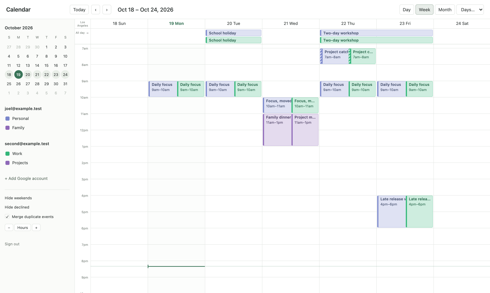

# 🧪 Potion Calendar

A personal Google Calendar app for Joel: one week view over every linked Google account, behind an allowlisted Google sign-in. Calendar behavior comes from the read-only `spec/` corpus.



The screenshot is the development build against the in-process Google fake. The accounts and events are fixtures.

## Run locally

```sh
pnpm install
pnpm dev
```

Development runs the actual Worker, D1 migrations, and per-person Durable Objects in Miniflare. An in-process Google fake checks state, one-use codes, callback URLs, and PKCE. Outbound requests terminate in that fake; no live Google connection or application secrets are needed.

The first session starts with `joel@example.test` and linked `second@example.test`. Each account has two calendars. Sign out to exercise sign-in again. Use **Add Google account** to link an account, or choose `refused@example.test` to exercise refusal. D1 and Durable Object data reset when the dev server restarts.

`portless list` shows the named route for this checkout. If no shared proxy is running, use the loopback-only fallback:

```sh
PORTLESS=0 pnpm dev
```

Do not start or reconfigure a shared proxy just to run this checkout. Client HMR stays enabled. Restart `pnpm dev` after changing server code, development adapters, or SQL migrations; the Worker bundle is built once at startup.

### Simulate an external Google change

Open the signed-in calendar first so its live connection registers Google watches. Send this request to the same development origin printed by Vite, or to its existing Portless route:

```sh
curl -X POST http://127.0.0.1:5173/__fake-google/change \
  -H 'content-type: application/json' \
  -d '{"email":"joel@example.test","calendarId":"joel@example.test","eventId":"overlap","summary":"Changed outside Calendar"}'
```

The fake patches its provider event, then sends a Google-shaped notification through `/google/push`. The real Durable Object drains the job and publishes a calendar invalidation after the cursor/version commit. The response reports accepted notifications and HTTP statuses. Expect `{"delivered":1,"statuses":[200]}` once watches are registered. This endpoint exists only in development.

## What is in the stack

| Component                    | Pin              |
| ---------------------------- | ---------------- |
| Node                         | `>=24.18.0`      |
| pnpm                         | `11.3.0`         |
| Effect and platform packages | `4.0.0`          |
| XState                       | `6.0.0-alpha.69` |
| `@xstate/effect`             | `1.0.0-alpha.8`  |
| Alchemy                      | `2.0.0-beta.83`  |
| Better Auth                  | `1.6.2`          |
| Foldkit                      | `0.167.0`        |
| TypeScript                   | `7.0.2`          |
| `@effect/tsgo`               | `0.51.1`         |
| Oxlint                       | `1.88.0`         |
| Oxfmt                        | `0.68.0`         |
| Ultracite                    | `7.12.0`         |
| Turborepo                    | `2.11.2`         |
| varlock                      | `1.23.0`         |

Dependencies stay exact. The compiler, typed lint, behavioral tests, and Git hooks form the fence.

## Modules

| Path | Job |
| --- | --- |
| `apps/web` | Foldkit account shell and its single Worker |
| `apps/infra` | `Calendar` Alchemy Stack, production stage `CalendarProd` |
| `packages/core` | Shared session contract and fence tests |
| `packages/auth` | Google OAuth, allowlist, encrypted tokens, person-scoped token adapter, dev-only fakes |
| `packages/database` | D1 migrations and database ports |
| `packages/capability` | Contracts and their projections |
| `packages/devtools` | Development-only capability and actor inspection |
| `packages/check-harness` | Typed check verdicts |
| `packages/deploy` | Profile-only plan, apply, watch, and approved rollback |

The calendar-core lane owns `packages/calendar`. This scaffold does not edit it.

## Authentication

Production enables only Google OAuth. Better Auth's generic OAuth plugin gates both sign-in and explicit linking at userinfo, before account writes. Google must return a verified, allowlisted email.

The authorization request uses `openid email profile https://www.googleapis.com/auth/calendar`, offline access, consent, and PKCE.

Configure Google's authorized redirect URI as:

```text
https://calendar.wzrrd.sh/auth/oauth2/callback/google
```

Better Auth encrypts access and refresh tokens. We discard ID tokens after the callback; the installed encryption option does not encrypt those. Keep `BETTER_AUTH_SECRET` stable across deployments. Changing it invalidates sessions and encrypted credentials.

`@calendar/auth/google-tokens` exports `googleTokensFor(auth, userId, config)`. It returns `accounts()` and `accessToken(accountId, options)`. Tokens are `Redacted<string>` and never enter the browser Model. A Google `invalid_grant` clears the stored tokens and marks that account disconnected. Other provider and storage faults remain errors.

## Checks

```sh
pnpm env:check
pnpm turbo run check test build --concurrency=1
```

`spec/**` is source corpus, not application code. Lint and formatting exclude it. No application rule or severity is relaxed.

## Deployment

The desk deploys from the operator machine. Workers do not contact live Google or deploy Cloudflare resources.

The Stack declares one Worker, D1, a per-person Durable Object namespace, and the Worker's `calendar.wzrrd.sh` custom domain. The custom domain resolves `wzrrd.sh` by name. The Stack owns no Zone, standalone DNS record, DNSSEC setting, or mail resource. It must never reconcile the existing wildcard or any other record.

Supply these application keys through `.env.schema`:

- `GOOGLE_CLIENT_ID`
- `GOOGLE_CLIENT_SECRET`
- `BETTER_AUTH_SECRET`
- `ALLOWED_EMAILS`, a comma-separated list

Alchemy credentials come only from a named profile. Set `ALCHEMY_PROFILE` to the same profile passed to the driver.

```sh
pnpm deploy:plan --profile wzrrd
pnpm deploy:prod --profile wzrrd --yes
```

Inspect and explicitly allow the initial creates. Deploy checks prove the served release, anonymous session isolation, refusal page, and absence of development and retired public endpoints. Google consent still needs a live owner check.

Rollback requires explicit approval: revert the code, then use `pnpm deploy:rollback --profile wzrrd --yes` with the prior receipt. Receipts live in gitignored `.rat/deploy/`.

## About `spec/`

The product description this app is built from (`spec/`) is kept private and is not part of this repository. Agent instructions that mention it refer to that private corpus.
